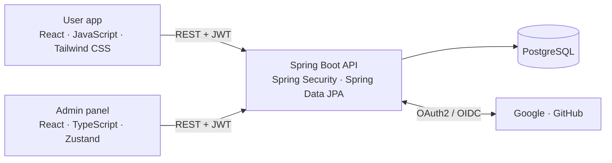

# PromptDex

A full-stack platform for discovering, sharing and rating AI prompts – built with a Spring Boot REST API, a React user app and a React/TypeScript admin panel.


**At a glance**

- 36 REST endpoints in a layered Spring Boot backend
- Stateless JWT authentication, social login with Google and GitHub, role-based access control
- 88 automated unit and integration tests
- Two React frontends: a public user app and an admin panel
- The complete platform starts with a single `docker compose up`

---

## Contents

- [Features](#features)
- [Architecture](#architecture)
- [Security](#security)
- [Tech stack](#tech-stack)
- [Project structure](#project-structure)
- [Getting started](#getting-started)
- [Configuration](#configuration)
- [Creating the first admin](#creating-the-first-admin)
- [Running the tests](#running-the-tests)
- [API overview](#api-overview)
- [Roadmap](#roadmap)
- [License](#license)

---

## Features

### User app

- **Accounts:** registration and login with username and password, or with a Google or GitHub account
- **Prompts:** create, edit and delete prompts with title, prompt text, description, target AI model, category and tags
- **Search:** keyword search across title, description and prompt text, combined with tag filters; results are paginated and sorted by newest first
- **Reviews and ratings:** rate and review prompts; each prompt shows its average rating
- **Bookmarks and collections:** save prompts and organize them into named collections
- **Social:** user profiles, following other users, and a personal activity feed with the latest prompts from followed users

### Admin panel

- **Dashboard** with totals for users, prompts and reviews
- **User management:** paginated list, search by username or email, edit roles
- **Content moderation:** paginated lists of prompts and reviews with search and delete
- Accessible only to accounts with `ROLE_ADMIN`

---

## Architecture



The backend follows a layered design:

| Layer | Responsibility |
|---|---|
| `controller` | REST endpoints for users and admins, request validation |
| `service` | Business logic and transactions |
| `repository` | Spring Data JPA repositories; JPQL queries with `JOIN FETCH` to avoid N+1 queries |
| `dto` / `mapper` | Request and response objects, decoupled from the JPA entities |
| `security` | JWT filter and token provider, OAuth2/OIDC user services |
| `exception` | Global exception handler with consistent error responses |

---

## Security

- **Stateless authentication:** every request carries a signed JWT (HMAC, valid for 24 hours by default); no server-side sessions
- **Social login:** OAuth2 with GitHub and OpenID Connect with Google; new users are registered automatically on first login
- **Passwords** are hashed with BCrypt
- **Role-based access control** on two levels: URL rules in the security filter chain and `@PreAuthorize` on admin controllers and services
- **CORS** is restricted to the local frontend origins

---

## Tech stack

| Area | Technologies |
|---|---|
| Backend | Java 17, Spring Boot 3.5, Spring Web, Spring Security, Spring Data JPA (Hibernate), Bean Validation, JJWT, Lombok, Maven |
| Database | PostgreSQL 16; H2 in-memory for tests |
| User app | React 18, JavaScript, Vite, Tailwind CSS, React Router, Axios |
| Admin panel | React 19, TypeScript, Vite, Zustand, React Router, Axios |
| Testing | JUnit 5, Mockito, MockMvc, Spring Security Test, `@DataJpaTest` |
| Deployment | Docker multi-stage builds, Docker Compose, Nginx for the user app |

---

## Project structure

```
promptdex/
├── backend/                     Spring Boot REST API
│   ├── src/main/java/com/promptdex/api/
│   │   ├── config/              security, CORS, application properties
│   │   ├── controller/          REST controllers (admin/ for the admin API)
│   │   ├── dto/                 request and response objects
│   │   ├── exception/           custom exceptions, global handler
│   │   ├── mapper/              entity-to-DTO mapping
│   │   ├── model/               JPA entities
│   │   ├── repository/          Spring Data JPA repositories
│   │   ├── security/            JWT and OAuth2/OIDC
│   │   └── service/             business logic
│   ├── src/test/                unit and integration tests
│   └── Dockerfile
├── frontend/                    user app (React, JavaScript, Tailwind CSS)
│   ├── Dockerfile
│   └── nginx.conf
├── promptdex-admin-frontend/    admin panel (React, TypeScript, Zustand)
├── docker-compose.yml
└── .env.example
```

---

## Getting started

### Option A: Docker Compose (recommended)

Requirements: Docker with Docker Compose.

```bash
git clone https://github.com/danieldanieltesting/promptdex.git
cd promptdex
cp .env.example .env        # then set your own values in .env
docker compose up --build
```

| Service | URL |
|---|---|
| User app | http://localhost:5173 |
| REST API | http://localhost:8080/api |
| PostgreSQL | localhost:5432 |

The admin panel is not part of the Compose setup. Start it locally as described in step 4 below.

### Option B: Local development

Requirements: JDK 17 or newer, Node.js 20 or newer, and PostgreSQL 16 (or start only the database with `docker compose up -d db`).

**1. Configure the backend.** Create `backend/src/main/resources/application.properties`. This file is ignored by Git, so your credentials stay local.

```properties
spring.datasource.url=jdbc:postgresql://localhost:5432/promptdex_db
spring.datasource.username=promptdex
spring.datasource.password=change-me
spring.jpa.hibernate.ddl-auto=update

jwt.secret=change-me-to-a-long-random-string
jwt.expirationInMs=86400000

app.oauth2.authorized-redirect-uris[0]=http://localhost:5173/oauth2/redirect

spring.security.oauth2.client.registration.google.client-id=your-google-client-id
spring.security.oauth2.client.registration.google.client-secret=your-google-client-secret
spring.security.oauth2.client.registration.github.client-id=your-github-client-id
spring.security.oauth2.client.registration.github.client-secret=your-github-client-secret
```

The four OAuth2 entries must exist for the application to start. If you don't need social login, keep the placeholder values.

**2. Start the backend.**

```bash
cd backend
./mvnw spring-boot:run      # on Windows: mvnw.cmd spring-boot:run
```

**3. Start the user app.**

```bash
cd frontend
npm install
npm run dev
```

**4. Start the admin panel.**

```bash
cd promptdex-admin-frontend
npm install
npm run dev
```

If the user app already runs on port 5173, Vite starts the admin panel on the next free port, usually 5174.

---

## Configuration

With Docker Compose, all secrets are read from `.env`, which is excluded from Git. `.env.example` lists every variable.

| Variable | Required | Description |
|---|---|---|
| `POSTGRES_USER` | no | Database user (default: `promptdex`) |
| `POSTGRES_PASSWORD` | yes | Database password |
| `POSTGRES_DB` | no | Database name (default: `promptdex_db`) |
| `JWT_SECRET` | yes | Key for signing JWTs, at least 64 characters. Generate one with `openssl rand -hex 64` |
| `GOOGLE_CLIENT_ID`, `GOOGLE_CLIENT_SECRET` | no | Credentials for Google login |
| `GITHUB_CLIENT_ID`, `GITHUB_CLIENT_SECRET` | no | Credentials for GitHub login |

Without OAuth2 credentials the application still starts; login with username and password works, social login does not.

**Setting up social login**

| Provider | Where to create the app | Redirect / callback URL |
|---|---|---|
| Google | Google Cloud Console → APIs & Services → Credentials | `http://localhost:8080/login/oauth2/code/google` |
| GitHub | GitHub → Settings → Developer settings → OAuth Apps | `http://localhost:8080/login/oauth2/code/github` |

---

## Creating the first admin

New accounts receive `ROLE_USER`. To access the admin panel, register a user in the user app and grant the admin role in the database:

```sql
INSERT INTO user_roles (user_id, role_name)
SELECT id, 'ROLE_ADMIN' FROM users WHERE username = 'your-username';
```

With Docker Compose, open a database shell with:

```bash
docker exec -it promptdex-db psql -U promptdex -d promptdex_db
```

Log in to the admin panel again afterwards so that the new role is included in the token.

---

## Running the tests

```bash
cd backend
./mvnw test                 # on Windows: mvnw.cmd test
```

The tests run against an in-memory H2 database, so no PostgreSQL instance is needed.

| Layer | Tests | Approach |
|---|---|---|
| Services | 39 | Unit tests with Mockito |
| Controllers | 40 | Integration tests with `@SpringBootTest` and MockMvc, including authentication and authorization |
| Repositories | 9 | `@DataJpaTest` against H2 |

---

## API overview

All endpoints are prefixed with `/api`. Endpoints marked "auth" require a valid JWT in the `Authorization: Bearer <token>` header.

| Area | Method and path | Access |
|---|---|---|
| Auth | `POST /auth/register`, `POST /auth/login` | public |
| Prompts | `GET /prompts?search=&tags=&page=&size=`, `GET /prompts/{id}`, `GET /prompts/user/{username}` | public |
| | `POST /prompts`, `PUT /prompts/{id}`, `DELETE /prompts/{id}`, `POST /prompts/{id}/tags` | auth |
| Bookmarks | `POST /prompts/{id}/bookmark`, `DELETE /prompts/{id}/bookmark`, `GET /prompts/bookmarks`, `GET /users/me/bookmarks` | auth |
| Reviews | `POST /prompts/{promptId}/reviews`, `PUT /reviews/{reviewId}`, `DELETE /reviews/{reviewId}` | auth |
| Collections | `GET /collections`, `POST /collections`, `GET /collections/{id}`, `PUT /collections/{id}`, `DELETE /collections/{id}`, `PUT /collections/{id}/prompts/{promptId}`, `DELETE /collections/{id}/prompts/{promptId}` | auth |
| Users | `GET /users/{username}/profile`, `GET /users/{username}/prompts` | public |
| | `POST /users/{username}/follow`, `POST /users/{username}/unfollow` | auth |
| Feed | `GET /feed` | auth |
| Tags | `GET /tags` | public |
| Admin | `GET /admin/stats`, `GET /admin/users`, `PUT /admin/users/{userId}/roles`, `GET /admin/prompts`, `DELETE /admin/prompts/{promptId}`, `GET /admin/reviews`, `DELETE /admin/reviews/{reviewId}` | `ROLE_ADMIN` |

---

## Roadmap

**Engineering**

- [ ] Continuous integration with GitHub Actions (build and tests on every push)
- [ ] Database migrations with Flyway instead of `ddl-auto=update`
- [ ] Refresh tokens and token storage in HttpOnly cookies
- [ ] Full-text search with PostgreSQL for large datasets
- [ ] Cloud deployment

**Product**

- [ ] Private prompts and collections
- [ ] Prompt versioning
- [ ] Real-time notifications
- [ ] Advanced filters and charts in the admin panel

---

## License

Released under the MIT License. See [LICENSE](LICENSE) for details.
